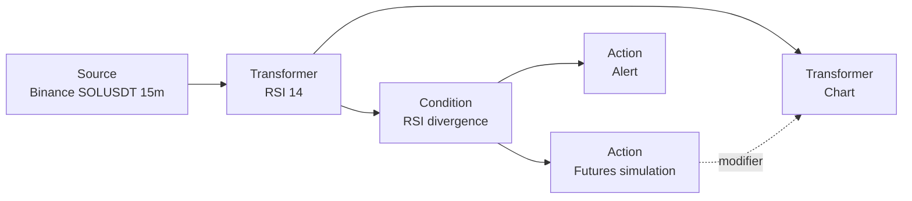

# ilus — Specification

> Status: draft · Last updated: 2026-11-24

## 1. Overview
ilus is a market-monitoring bot that fetches market data from **sources**, detects user-defined **conditions** (e.g. candlestick patterns on the price chart), and executes the associated **action** when a condition triggers.

Two extra concepts make the pipeline flexible: **transformers** derive new sources from existing ones (e.g. an RSI source computed from a price source), and **modifiers** let an action send information back to a condition to change how it operates.

ilus is **not a trading-strategy engine**. It does not model strategies in terms of buy/sell signals, positions, or portfolio management. Its core abstraction is generic: *condition → action*. Placing an order is just one possible action among others (e.g. sending a notification, logging, calling a webhook).

## 2. Goals
- Fetch market data through pluggable **sources**. A default source is provided: a free, public crypto price/volume feed with 1-minute precision.
- Derive new sources from existing ones through **transformers** (e.g. price → RSI). Transformers can be chained.
- Detect conditions on asset prices or related data, typically patterns on the candlestick chart (e.g. hammer, engulfing, doji). A set of predefined conditions is provided.
- When a condition triggers, execute its associated action. A set of predefined actions is provided.
- Run as a long-lived bot: once started, it evaluates all defined conditions continuously and indefinitely.
- **No event is lost**: every detection reaches its actions within the tick; a slow action makes the tick longer, it never drops events.
- **Scale to hundreds of entities**: entities are nodes of a graph run by a single executor, tick by tick (§5).
- Let actions change how a condition operates by sending it **modifiers** (e.g. switch the threshold set, watch only bearish patterns).
- Conditions are evaluated independently: while an action runs, other conditions keep being evaluated.
- The graph (sources, transformers, conditions, actions and their links) is **defined in Rust code**, not in a configuration file, with a statically typed builder.
- Source, transformer, condition, action and modifier types are implemented in Rust.

## 3. Non-goals
- Production readiness: ilus is a proof of concept (POC).
- Tooling to help develop new conditions or actions (no DSL, scripting, or UI).
- Configuration files: no JSON/TOML/YAML config for now. Changing the graph means editing the code and rebuilding.
- Trading-strategy features: buy/sell signal modeling, position/portfolio management, backtesting, strategy optimization.

## 4. Glossary
| Term | Definition |
|------|------------|
| Source | A stream of data items used by conditions. Either a **provider source** (a **provider**, an **asset** and a **timeframe**; delivers closed candles) or a **transformed source** (another source passed through a transformer). |
| Transformer | Rust-implemented process that turns one source into another (e.g. price candles → RSI values). Its output is a new source. |
| Data item | One element of a source stream: a candle for provider sources, or the transformer's output type (e.g. an RSI value) for transformed sources. Always closed and timestamped. |
| Provider | Rust-implemented connector to a market-data service (e.g. Binance). |
| Timeframe | Duration of one candle (e.g. `1m`, `5m`, `1h`). |
| Condition | Rust-implemented detector that consumes a source's data stream and emits trigger events. It can be anything; candlestick patterns are the first kind provided. |
| Action | Rust-implemented operation executed when a condition triggers (e.g. send notification, call webhook, place order). Actions are generic, not limited to trading. |
| Candle | OHLCV bar (open, high, low, close, volume) for an asset over a fixed timeframe. |
| Pattern | A recognizable shape formed by one or more consecutive candles. |
| Graph | The entities (sources, transformers, conditions, actions) and their links, built in Rust code with a typed builder. |
| Executor | Runs the graph tick by tick (§5). |
| Tick | One call of a source by the executor, followed by the evaluation of the nodes downstream of the new item and the propagation of the events. |
| Running mode | Bootstrap (warm-up, no action events), replay (history with action events) or normal (live). Set by the source, carried in each data item. |
| Trigger event | Event emitted by a condition when it detects something; it is the input of the action. |
| Modifier | Event sent to a condition or a transformer, mostly by an action, carrying information that changes how it operates (e.g. new thresholds, watched direction, chart marker). |
| Price stream | Real-time feed of market data for an asset. |

## 5. Architecture — graph executor
> Replaces the first implementation (one task and one channel per link, `Rule`, `Bot`), which does not scale to hundreds of entities.

### 5.1 Graph
Entities are the nodes of a **graph**, built in Rust code with a typed builder. A link is an edge from an output to an input.



```rust
let mut g = Graph::new();
let sol     = g.source(BinanceSource::new("SOLUSDT", M15));                // Output<Candle>
let sol_rsi = g.transform(Rsi::new(14)?, &sol);                            // Output<RsiCandle>
let div     = g.condition("div", RsiDivergence::default(), &sol_rsi);      // ConditionOutput<Divergence, RsiCandle>
let chart   = g.transform(chart, &sol_rsi);                                // fan-out: same output used twice
let markers = g.modifier_handle(&chart);                                   // ModifierHandle<ChartModifier>
g.action(Futures::new(.., markers), &div);
g.action(Alert::new(), &div);                                              // several actions on one condition
Executor::new(g).run()?;                                                   // blocking, on this thread
```

- **Typed builder**: every builder call returns a typed handle (`Output<T>`); connecting an entity to an output of the wrong type is a **compile error**. Internally the executor stores nodes as trait objects (`dyn`), the only way to hold hundreds of entities of different types.
- **Fan-out**: an output can feed any number of transformers and conditions; consumers read the item **by reference** (no copy).
- A transformer or a condition has **exactly one input**. To combine data:
  - a **merge source** (F1) is built from two sources **before** the graph, and is added to the graph as one ordinary source;
  - a **combined transformer** (F4) runs several transformers on the same input, as one node.

  Splitting needs no special node: it is fan-out. There is no merge or split of transformer outputs.
- **A transformer or a condition never processes the same value twice.** The executor skips any input item that is not strictly newer (by time) than the last one the node processed. Adapters reading a part of an item (e.g. the slower side of a merged item, which repeats) check that this part is new before processing it (F4).
- A condition can feed **several actions**. An action is connected to **exactly one condition**, and has one input value type, defined by the action. If two conditions need the same behaviour, each gets **its own action instance**. Actions can have state (e.g. a simulated wallet), private to the instance.
- The graph is acyclic by construction (an entity can only be connected to existing outputs). Modifiers are not edges: they go back from actions to a condition or a transformer through a typed handle.
- There is no `Rule` and no channel between entities anymore.

### 5.2 Execution: a sync executor thread, an async runtime
Blocking work and async work are never mixed: at least two threads.
- The **executor thread** (the thread calling `Executor::run`, a blocking call) runs the ticks: sources' calls, transformers, conditions and actions, **all sync**, with a blocking sleep between ticks. A slow transformer, condition or action only makes the tick longer; it never blocks async work.
- An **async runtime** (tokio, multi-threaded, 1 worker by default, `with_async_threads`), created and owned by the executor, runs on its own threads the **network work**: sources' fetches (history, live requests), and the work started by actions with `ActionContext::spawn` (e.g. sending an order). Results come back as modifiers (`ActionContext::deferred`), applied at the end of the first tick after they arrive.
- A source call never blocks: it starts its network work on the runtime and returns the next item if one is ready.
- `Executor::run` must be called from a thread, not from an async task (it returns an error). At the end, pending async work gets a few seconds to finish.

### 5.3 Running modes
The running mode is set by the **source** and carried **in each data item**; transformers keep the mode of their input; the executor reads it from the data.

| Mode | Data | Events sent to actions | Ticks |
|---|---|---|---|
| **Bootstrap** | history before the start, to warm up transformers and conditions (length computed from the graph, §5.4) | **no** (conditions only update their state) | global tick, every 10 ms |
| **Replay** | history over a chosen period (backtests) | yes | global tick, every 10 ms |
| **Normal** | live data | yes | per source, aligned on candle close |

A source always starts with **bootstrap**, then goes to **normal** (live) or **replay** (backtest; the source ends after the replay period). The source switches mode by itself.

### 5.4 Ticks
- **Bootstrap and replay**: one **global tick every 10 ms** (configurable; can be lowered if too slow). At each tick, every source in bootstrap or replay is called **one after the other**, in graph order, and delivers **one item**. The source periods are not respected (sources with different timeframes are not time-aligned).
- **Normal**: each source is called **just after each expected candle close** (close + 2 s by default). If the candle is not available yet, it is called again every **half period** (30 s for 1m) until it is.
- A tick of a source that returns no item does nothing downstream.
- **Bootstrap length**: each transformer and condition declares how many items it needs (`warm_up()`). When the graph is built, each source gets a bootstrap length equal to the **maximum, over every path downstream of it, of the sum of the warm-ups along the path** (e.g. RSI(14) needs 15, divergence needs `left + 1 + right` = 7: the source bootstraps 22 candles). A source may ask for more.

### 5.5 Tick processing
A tick is **fully sequential**:
1. **Sources**: call every due source; each returns zero or one item.
2. **Transformers and conditions**: for each new item, evaluate the downstream nodes in graph order. Each node runs at most once per item.
3. **Actions**: for every detection (except from bootstrap items), run the connected actions, in graph order (sync, on the executor thread).
4. **Modifier rounds**: apply the modifiers produced during the tick (then those sent by async work since the previous tick), in the order they were sent. A modifier is one of the rules of a condition: when applying it makes the condition trigger, its actions run **in the same tick**, with the condition's **last input item**. Modifiers sent by these actions are applied in a new round, and so on until none is left (at most `MAX_MODIFIER_ROUNDS` = 16 rounds per tick; the rest is applied at the next tick, with a log).
5. Next tick.

Consequences:
- A modifier is always applied **within the tick in which it is produced** (before the next tick), in every mode: execution is deterministic, also in bootstrap and replay.
- What triggers a condition does not matter (new data, a modifier from another chain, the result of async work): its actions run with its last input item. A detection caused by a modifier before any data is dropped (logged); it cannot happen after the bootstrap.
- Example: chain B (Binance RSI 15m) arms, with a modifier, a condition of chain K (Kucoin RSI 1h) whose last RSI is already low: K triggers in the same tick, even if K has just processed a candle in that tick.
- Nothing piles up between entities: there is no event queue and no backpressure mechanism. A slow action simply makes the tick longer; the next tick waits.

### 5.6 End of execution
- The executor stops when every source has ended (replay). A live source never ends.

### 5.7 Acceptance criteria
- [ ] Wrong connections (types) are compile errors.
- [ ] One output feeds several consumers; each node runs once per item.
- [ ] Nodes run in graph order within a tick; nodes not downstream of a source with a new item do not run.
- [ ] Bootstrap items reach conditions but produce no action event; replay and normal items do.
- [ ] Bootstrap and replay: one item per source per global tick, sources called in graph order.
- [ ] Normal: a source is called at candle close + delay, then every half period until the candle is available.
- [ ] Within a tick: sources, then transformers and conditions, then actions, then modifier rounds.
- [ ] A modifier produced during a tick is applied in that tick, in every mode.
- [ ] A condition can trigger on a modifier: its actions run in the same tick, with its last input item; their modifiers are applied in the next round.
- [ ] Modifier rounds are limited per tick; the remaining modifiers are applied at the next tick.
- [ ] Every detection (except bootstrap) reaches its actions; none is lost.
- [ ] Bootstrap length per source = max over downstream paths of the sum of warm-ups.
- [ ] The executor stops when all sources have ended.
- [ ] Replay backtests are deterministic (same input → same events, same modifiers, same results).

## 6. Domain model
```rust
// Sketch of the graph-executor design (§5); final signatures decided at implementation.

/// Running mode, set by the source and carried in every data item.
enum Mode { Bootstrap, Replay, Normal }

/// One closed, timestamped data item.
trait SourceData: Debug + Send + Sync + 'static {
    fn time(&self) -> DateTime<Utc>;
}

/// What a node receives: the item and its running mode.
struct Item<'a, D> { data: &'a D, mode: Mode }

struct Candle {
    open_time: DateTime<Utc>,
    open: Decimal, high: Decimal, low: Decimal, close: Decimal,
    volume: Decimal,
}

/// A source is called by the executor at each of its ticks; it never blocks
/// (network work runs in the background).
trait Source: Send + 'static {
    type Data: SourceData;
    fn info(&self) -> SourceInfo;
    /// Bootstrap length computed from the graph (called once, before the first call).
    fn set_bootstrap(&mut self, items: usize);
    /// Current mode: bootstrap and replay sources are called at every global tick.
    fn mode(&self) -> Mode;
    /// Next closed item, if one is ready, with its mode; `Ended` after a replay.
    fn poll(&mut self, now: DateTime<Utc>) -> SourcePoll<Self::Data>;
    /// When the executor must call it next (bootstrap/replay: global tick;
    /// normal: next candle close + delay, or half period).
    fn next_call(&self, now: DateTime<Utc>) -> Schedule;
}

/// Sync: called for each new input item; the output forwards the input.
trait Transformer: Send + 'static {
    type Input: SourceData;
    type Value: Debug + Send + Sync + 'static;
    type Modifier: ModifierValue;
    /// Items needed before the first value (used for the bootstrap length).
    fn warm_up(&self) -> usize;
    fn on_data(&mut self, item: Item<'_, Self::Input>) -> Option<Self::Value>;
    fn on_modifier(&mut self, m: Self::Modifier) -> Result<(), ModifierError>;
}
/// Output of a transformer: the input item plus the computed value.
struct Derived<D, V> { data: D, value: Option<V> }

/// Sync: called for each new input item.
trait Condition: Send + 'static {
    type Input: SourceData;
    type Value: TriggerValue;
    type Modifier: ModifierValue;
    /// Items needed before the first possible detection (bootstrap length).
    fn warm_up(&self) -> usize;
    fn on_data(&mut self, item: Item<'_, Self::Input>) -> Option<Detection<Self::Value>>;
    /// A modifier is one of its rules: it may make the condition trigger.
    fn on_modifier(&mut self, m: Self::Modifier)
        -> Result<Option<Detection<Self::Value>>, ModifierError>;
}
struct Detection<V> { event_type: TriggerEventType, value: V }

/// Event given to an action (never for bootstrap items). The action runs
/// within the tick, so the event borrows the detection and the item (no copy).
struct TriggerEvent<'a, V, D> {
    condition: &'a str,           // name of the condition node
    event_type: TriggerEventType,
    value: &'a V,
    source: &'a SourceInfo,
    time: DateTime<Utc>,          // time of the triggering item
    mode: Mode,                   // replay or normal
    data: &'a D,                  // the triggering item (condition input)
}

/// Connected to exactly one condition: its value and input types. Sync, on
/// the executor thread; network work is started with `ctx.spawn` on the async
/// runtime (copying what it needs).
trait Action: Send + 'static {
    type Value: TriggerValue;
    type Input: SourceData;
    fn run(&mut self, event: TriggerEvent<'_, Self::Value, Self::Input>,
        ctx: &mut ActionContext) -> Result<(), ActionError>;
}

/// Lets an action send modifiers (applied at the end of the tick), start
/// async work on the runtime (`spawn`), get a deferred sender for that work,
/// and read the executor time.
struct ActionContext { /* modifiers produced during the tick */ }

/// Typed handle to send modifiers to a condition or a transformer
/// (obtained from the graph builder, given to actions; used with ActionContext).
struct ModifierHandle<M> { /* node id */ }

/// Typed builder: handles carry the output type (and the modifier type of the
/// node), so wrong links do not compile.
struct Graph { /* nodes as trait objects, edges */ }
struct Output<T, M = NoModifier> { /* node id */ }
impl Graph {
    fn source<S: Source>(&mut self, s: S) -> Output<S::Data>;
    fn transform<T: Transformer, M>(&mut self, t: T, input: &Output<T::Input, M>)
        -> Output<Derived<T::Input, T::Value>, T::Modifier>;
    fn condition<C: Condition, M>(&mut self, name: &str, c: C, input: &Output<C::Input, M>)
        -> ConditionOutput<C::Value, C::Input, C::Modifier>;
    fn action<A: Action, M>(&mut self, a: A, c: &ConditionOutput<A::Value, A::Input, M>);
    /// Typed handle to send modifiers to the node of `output` (transformer or condition).
    fn modifier_handle<H: NodeHandle>(&self, output: &H) -> ModifierHandle<H::Modifier>;
}

/// Runs the graph tick by tick (§5.5) until every source has ended. The clock
/// is the system clock, or a simulated clock (tests: waiting only advances it).
struct Executor { /* graph, tick, clock */ }
```

## 7. Features

### F0 — Predefined candlestick pattern conditions
**Why:** Candlestick patterns are the primary kind of condition ilus detects. A reference set of 13 classic patterns is provided out of the box.

**General rules:**
- A pattern is only checked once its last candle has **closed**. A trigger is never emitted for a candle still in progress, and once emitted it is never withdrawn.
- A given pattern triggers at most once per candle.
- Multiple patterns can match the same candle: the condition emits **one detection listing every match**, in table order; its event type is the first match. A condition can watch only some patterns (`only(&[...])`, e.g. one condition per pattern) or one signal (modifier `WatchOnly(Bullish | Bearish)`).
- Detection starts only once enough closed candles exist to compute the averages (`AVG_LEN`) and the trend reference used by the pattern.

**Candle measures** — computed on a closed candle with open `O`, high `H`, low `L`, close `C`:
- **Body**: distance between open and close, `|C − O|`.
- **Range**: full height of the candle, `H − L`.
- **Upper shadow**: part above the body, `H − max(O, C)`.
- **Lower shadow**: part below the body, `min(O, C) − L`.
- **Bullish / bearish**: the candle closed higher (`C > O`) / lower (`C < O`) than it opened.
- **Midpoint** of a candle's body: `(O + C) / 2`.
- **Typical body / typical range**: mean body / mean range of the `AVG_LEN` candles preceding the candle under test (the candle itself is excluded).
- **Prior trend**: *down* if the close is below its exponential moving average of period `TREND_LEN`, *up* if above, *flat* if equal. Patterns read the trend just **before** the pattern begins (on the candle preceding its first candle).
- **Equality tolerance**: two values are considered equal when they differ by less than `EPSILON × price`, so that exact threshold hits are handled consistently.

**Threshold sets:** candlestick definitions vary between authors and tools, so ilus is designed to support **several threshold sets** (e.g. strict, loose, author-specific). For now only one set is defined: `default`, holding the most commonly used values below. The implementation must keep thresholds as data (not hard-coded in pattern logic) so that new sets can be added without changing pattern code.

In code: `PatternCondition::new(ThresholdSet::default())`; a single value can be overridden (`ThresholdSet { long_shadow: dec!(3), ..Default::default() }`), and a set can be replaced while running with the modifier `SetThresholds` (except `AVG_LEN` and `TREND_LEN`, which size the history). Warm-up: `TREND_LEN + 3` candles (trend defined on the candle preceding a 3-candle pattern).

**Default threshold set (`default`):**

| Name | Default value | Meaning |
|---|---|---|
| `AVG_LEN` | 10 | candles used for typical body / range |
| `TREND_LEN` | 20 | EMA period for the prior trend |
| `LONG_SHADOW` | 2 | a "long" shadow is at least this many times the body |
| `SHADOW_SHARE` | 0.6 | a dominant shadow covers at least this share of the range |
| `TINY_SHADOW` | 0.1 | a "missing" shadow is at most this share of the range |
| `DOJI_BODY` | 0.05 | max body/range ratio for a doji |
| `DOJI_MIN_RANGE` | 0.5 | a doji's range must be at least this share of the typical range |
| `STAR_BODY` | 0.3 | max body of a star's middle candle, relative to the first candle's body |
| `EPSILON` | 1e-9 | relative equality tolerance |

**Patterns** — candles are named *first*, *second*, *third* in time order; the last one is the candle that just closed. Every pattern requires a non-zero range where ranges are used.

| # | Pattern | Signal | Candles | Definition |
|---|---|---|---|---|
| 0 | Bullish Engulfing | bullish | 2 | Prior trend down. First candle bearish, second bullish. Second body opens at or below the first close, closes at or above the first open, and is strictly larger than the first body. |
| 1 | Bearish Engulfing | bearish | 2 | Mirror of Bullish Engulfing: prior trend up, first bullish, second bearish and wrapping the first body. |
| 2 | Hammer | bullish | 1 | Prior trend down. Lower shadow ≥ `LONG_SHADOW` × body and ≥ `SHADOW_SHARE` × range; upper shadow ≤ `TINY_SHADOW` × range. |
| 3 | Hanging Man | bearish | 1 | Same shape as Hammer, prior trend up. |
| 4 | Inverted Hammer | bullish | 1 | Prior trend down. Upper shadow ≥ `LONG_SHADOW` × body and ≥ `SHADOW_SHARE` × range; lower shadow ≤ `TINY_SHADOW` × range. |
| 5 | Shooting Star | bearish | 1 | Same shape as Inverted Hammer, prior trend up. |
| 6 | Doji | opposite of prior trend | 1 | Body ≤ `DOJI_BODY` × range, range ≥ `DOJI_MIN_RANGE` × typical range, prior trend not flat. |
| 7 | Morning Star | bullish | 3 | Prior trend down. First candle bearish with a body at least the typical body. Second candle's body ≤ `STAR_BODY` × first body, and its lower body edge at or below the first close. Third candle bullish, closing above the first candle's midpoint. |
| 8 | Evening Star | bearish | 3 | Mirror of Morning Star: prior trend up, first bullish, second small with its upper body edge at or above the first close, third bearish closing below the first midpoint. |
| 9 | Bullish Harami | bullish | 2 | Prior trend down. First candle bearish with a body at least the typical body. Second candle bullish, its body contained within the first body and strictly smaller. |
| 10 | Bearish Harami | bearish | 2 | Mirror of Bullish Harami: prior trend up, first bullish and large, second bearish and contained. |
| 11 | Piercing Line | bullish | 2 | Prior trend down. First candle bearish with a body at least the typical body. Second candle bullish, opens at or below the first close, closes strictly between the first midpoint and the first open. |
| 12 | Dark Cloud Cover | bearish | 2 | Mirror of Piercing Line: prior trend up, first bullish and large, second bearish opening at or above the first close and closing strictly between the first open and the first midpoint. |

**Acceptance criteria:**
- [ ] Each of the 13 patterns has unit tests with at least one matching and one non-matching candle sequence, built from original hand-crafted data.
- [ ] Given a candle that is still forming, When it matches a pattern, Then no trigger fires until the candle closes.
- [ ] Given fewer closed candles than required for averages and trend, Then no pattern triggers.
- [ ] *(Optional, local only, never committed)* Results may be cross-checked against other open-source detectors on the same price history; differences must be explainable by differing definitions.

**Edge cases & errors:**
- Zero-range candles (`H == L`): range-based patterns do not trigger (no division by zero).
- Values landing exactly on a threshold: resolved via `EPSILON`.
- Flat prior trend: trend-dependent patterns do not trigger.

### F1 — Sources
**Why:** Conditions need market data, and data can come from many providers (exchanges, APIs, files). A *source* isolates how data is fetched from how it is analysed, so conditions never depend on a specific provider.

**Behavior:**
- A **provider source** is defined by three elements:

  | Element | Meaning | Example |
  |---|---|---|
  | `provider` | where to get the feed | `binance` |
  | `asset` | the asset/pair to track, in the provider's symbol format | `BTCUSDT` |
  | `timeframe` | candle precision | `1m` |

  ```rust
  let btc_1m = g.source(BinanceSource::new("BTCUSDT", Timeframe::M1));
  ```
- A provider source delivers **closed candles** (OHLCV) in chronological order, one per tick at most (§5.4), each tagged with its running mode (§5.3).
- A **transformed source** is defined by an input source, a transformer and its parameters (see F4). It inherits the asset and timeframe of its input.
- A source is added once to the graph; its output can feed any number of consumers (fan-out, §5.1), with a single connection to the provider.
- Provider sources deliver **candles only** (price and volume). Other provider data (order book, trades, external indicators) is out of scope for now. Derived data (e.g. RSI) is produced by transformers.
- The timeframe of a provider source is requested directly from the provider and fixed at startup. Longer timeframes can also be built from it with the **aggregation transformer** (F4).
- Modes (§5.3): **bootstrap** warms up with the last closed candles before the start (length computed from the graph, §5.4, or more with `with_bootstrap(n)`; no action events); then either live data (**normal**), or `replay(from, to)`: every candle of the period, with action events, after which the source ends.
- A source signals whether a candle is closed; only closed candles are passed to conditions (see F0).
- **Merge source** (`MergeSource::new(main, other)`): combines two sources, a *driving* one (e.g. 15m) and a *slower* one (e.g. 1h), into one source. It is built before the graph and implements `Source`: the graph sees one source node. At each call it calls its inner sources when they are due, then returns at most one merged item. Bootstrap: the user sets, on each inner source, how many items the transformers behind it need (e.g. `with_bootstrap(15)` on the 1h source for an RSI(14) on 1h). The merge then reconciles the two: the slower source covers at least the duration of the driving bootstrap, and the **driving bootstrap is extended to cover the slower bootstrap** (15 × 1h: the first one is paired with the first driving items, the other 14 h = 56 × 15m), so that every slower bootstrap item is paired with at least one driving item.
  - It emits on **each item of the driving input**: `Merged { main: 15m item, other: Option<1h item> }`. The same 1h value is sent again with every 15m item until a newer one is available; `None` before the first one.
  - Items are paired **by time, not by tick**: the slower value is the last item of the slower input **closed at or before the close of the driving item** (no look-ahead: for the 15m candle 10:15–10:30, the 1h candle 09:00–10:00, not 10:00–11:00). For a driving item closing at `C`, the expected slower item opens at `floor(C, slower timeframe) − slower timeframe`.
  - **Accumulation**: the inputs are not time-aligned (one item per source per tick in bootstrap and replay, §5.4; background fetch delays; a late live request). The merge therefore keeps the driving items in a queue until the slower input has delivered the expected item, then emits them in order, **one per tick**. Slower items arriving early are buffered. Same rule in every mode; in normal mode there is normally no wait, because both sources are called in the same tick.
  - No deadlock: if the slower input has delivered an item after the expected one (missing candle at the provider) or has ended, the merge uses the last slower item it has.
  - The merged item has the running mode of the driving item. Within a tick all sources are called before the nodes, so in normal mode a slower candle closing at the same time as a driving candle is already available.
  - Bootstrap: each input gets the bootstrap length computed for the paths downstream of the merge (§5.4), counted in its own items.
- **Split**: no special node. An output can feed any number of consumers (fan-out, §5.1), which all read the same item by reference, i.e. a shared reference to the value produced by the input.

**Default source:**
- A free, public crypto feed that requires no account or API key.
- Provides price and volume (OHLCV) with **1-minute** precision.
- Live data by REST polling at the normal-mode ticks (§5.4): opening a connection costs little compared to the smallest period.
- Provider: **Binance public market-data API** (spot), default asset `BTCUSDT`, interval `1m`.
  - All data over REST: `GET https://api.binance.com/api/v3/klines?symbol=BTCUSDT&interval=1m&limit=1000` (max 1000 candles per call). No WebSocket.
  - Bootstrap and replay: history is fetched in the background by pages of 1000 candles; each tick takes one candle from that buffer.
  - Normal: at each tick, one request for the latest closed candles; candles missed since the last one are included, so a reconnection is just the next request.
  - Fallback endpoint (market data only): `https://data-api.binance.vision` (selectable with `with_endpoints`).
  - The symbol is checked at startup; an unknown symbol stops the source with `SourceError::Unknown`.
  - Failures at two levels:
    - each REST request is retried up to 5 times inside its task (backoff 1 s → 60 s; `Retry-After` honoured on HTTP 429/418);
    - every background task (history, live request) is **supervised**: the source keeps its handle and checks it at each call, without blocking. If the task fails (error or panic), the source **reconnects** up to `MAX_RECONNECTS` = 5 times, waiting **half its period** between attempts (30 s for 1m, 7.5 min for 15m), then ends with a log. History resumes after the last candle delivered (nothing delivered twice); live requests include the missed candles. A success resets the count.
    - An unknown symbol is a configuration error: the source ends at once, without reconnecting.
    - Running tasks are cancelled when the source is dropped.
  - Prices and volumes are received as strings and must be parsed to `Decimal` (never floats).

**Test sources:**
- **Mock source**: delivers hand-crafted candles from memory; used by `cargo test` (no network in automated tests).
- **Replay source** (optional): replays candles recorded from Binance in a JSON file, for manual end-to-end checks.

**Acceptance criteria:**
- [ ] Given a running default source for `BTC/USDT` 1m in normal mode, When a minute ends, Then exactly one closed candle is delivered, shortly after the close.
- [ ] Given several consumers of one source, Then only one connection to the provider is used.
- [ ] Given a bootstrap length `n` (computed from the graph), Then `n` closed candles tagged *bootstrap* are delivered before the replay or live candles.
- [ ] Given `replay(from, to)`, Then every candle of the period is delivered, tagged *replay*, then the source ends.
- [ ] A source can be replaced by a test/mock source delivering candles from memory, without changing condition code.

**Edge cases & errors:**
- Request failed in normal mode: reconnection after half a period (up to 5 times); the missed candles come with the next successful request, so none is skipped or duplicated.
- Duplicate or out-of-order candles from the provider: ignored.
- Missing candle: the source refetches it, up to N retries (with backoff); if it still fails, the error is logged and the source stops.
- Provider rate limits: respected; never exceeded.
- Unknown asset/timeframe at the provider: fail at startup with a clear error.

### F2 — Conditions
**Why:** Conditions are the detection stage of the pipeline. They are generic so that new kinds of detection (patterns, price thresholds, indicators, volume spikes…) can be added without changing sources or actions.

**Behavior:**
- A condition has **exactly one** input in the graph: a source (candles) or a transformer output (e.g. RSI values). It declares the data type it expects. It is **sync**: called by the executor for each new input item (§5.5).
- It keeps whatever internal state it needs (history window, indicators…).
- When it detects its situation, it emits a **detection**, turned into a trigger event for every connected action (§5.5). It emits at most one detection per item; a condition may emit detections of different types (e.g. one pattern condition can detect several patterns).
- In **bootstrap** mode it only updates its state: its detections are not sent to actions (§5.3). It can read the running mode of the item.
- It can also **trigger when it receives a modifier** (`on_modifier` may return a detection): a modifier is one of its rules, like the data. Its actions then run in the same tick, with its last input item (§5.5). Avoiding a double trigger (e.g. a repeated modifier) is part of the condition's rules.
- A condition knows nothing about providers, transformers or actions; it only sees data items, produces events and receives modifiers (F5).
- Each condition instance is independent: same type with different parameters = different instances.
- First kind provided: candlestick patterns (F0). Other kinds may be added later.

**Acceptance criteria:**
- [ ] Given a mock source feeding a known candle sequence, When a condition matches, Then exactly one trigger event is emitted with the triggering data item and the condition's value.
- [ ] Given a condition that does not match, Then no event is emitted.
- [ ] Given bootstrap items, Then the condition state is updated but no event reaches an action.
- [ ] A new condition type can be added by implementing the condition trait, with no change to sources or actions.

**Edge cases & errors:**
- A condition error (e.g. invalid internal state) is logged and does not stop the other conditions or the source.
- Condition input type does not match the source data type (e.g. a candlestick pattern on an RSI source): compile error.

### F3 — Actions
**Why:** Actions are the last stage of the pipeline: they react to trigger events.

**Behavior:**
- An action receives a trigger event and executes.
- An action is connected to **exactly one condition** and has one input value type. Two conditions needing the same behaviour use two instances. An action can keep **state** between events (e.g. a simulated wallet). It is **sync** and runs on the executor thread (§5.2). Network work is started on the async runtime with `ActionContext::spawn`, so the tick is not blocked; its result can come back with a deferred modifier.
- Events are processed one at a time, in detection order, within the tick.
- While running, an action may send **modifiers** to a condition or a transformer (F5), through handles given when the graph is built.
- Actions of a tick run after all conditions of that tick, in graph order.
- There is no dry-run mode; testing is done with the **alert** action.

**First action — Alert:**
- Writes the trigger event (condition, event type, value, source, time, data item) to the console/log. The value is printed via its `Debug` representation, so the alert action works with any condition.

**Acceptance criteria:**
- [ ] Given a trigger event, When the alert action runs, Then the event is printed with all its fields.
- [ ] Given a failing action, Then the error is logged and the tick continues with the next action.

### F4 — Transformers
**Why:** Many conditions work on derived data (indicators such as RSI) rather than raw prices. A transformer computes that data once and exposes it as a new source, so conditions stay simple and the computation is shared.

**Behavior:**
- A transformer takes **one input** (a source or another transformer) and produces **one output**. It is **sync**: called by the executor for each new input item (§5.5).
- The input can be a provider source or another transformed source: transformers can be **chained** (e.g. candles → EMA → RSI). Chains must be acyclic.
- A transformer **always forwards its input data**: for every input item it emits exactly one output item, `Derived { data, value }`, holding the input item unchanged and the computed value. Output items are therefore closed and in the same order as the input.
- During **warm-up** (not enough input yet, e.g. the first 14 changes for RSI 14), the value is `None`; the input item is still forwarded.
- The transformed source inherits the asset and timeframe of its input.
- Its output can feed any number of consumers (fan-out); it is computed once per item. Its items keep the running mode of the input (§5.3).

**EMA transformer** (Exponential Moving Average):
- Input: candles. Output: `EmaCandle = Derived<Candle, Decimal>`: each candle with the EMA of the closes, `None` during warm-up.
- Parameter: `period` (≥ 1). `EMA = previous EMA + k × (close − previous EMA)`, with `k = 2 / (period + 1)`. The first value is the plain mean of the first `period` closes. Warm-up: `period` candles.
- The same calculation (`EmaCalc`) is used by the prior trend of the candlestick patterns (F0).

**Aggregation transformer** (e.g. 1m → 5m):
- Builds candles of a longer timeframe from the input candles, on boundaries aligned to the clock (00:00, 00:05, …): open of the first candle, highest high, lowest low, close of the last one, sum of volumes.
- It emits on **each input candle**: `Derived { data: 1m candle, value: Option<5m candle> }`, where the value is the **last completed** 5m candle, sent again until the next one completes (`None` before the first one). A 5m candle is completed by the 1m candle that closes its period; the 5m candle still forming is never sent (closed data only).
- Warm-up: the ratio between the two timeframes (5 for 1m → 5m).

**Combined transformer** (`Combine::new((a, b))`, also with 3 transformers):
- Runs several transformers with the **same input type** as **one node**; its value is the tuple of their values, e.g. `(Option<rsi>, Option<sma>)`.
- Each inner transformer is called once per input item, in order. Warm-up: the largest one. Modifiers are routed to one inner transformer (`CombineModifier::First`, `Second`, `Third`).

**Adapters** (to read a part of an item, never processing the same value twice):
- `OnMain(t)` / `OnOther(t)`: run `t` on the driving / slower side of a merged item.
- `OnValue(t)`: run `t` on the value of a transformer output (e.g. the 5m candle of an aggregation).
- When the part read is the same as the last one processed (same time), the inner transformer is not called and the last value is returned. Example: RSI 15m + RSI 1h on a merged source: `Combine::new((OnMain(Rsi::new(14)?), OnOther(Rsi::new(14)?)))`; the 1h RSI only advances when a new 1h candle arrives.
- It declares its warm-up (`warm_up()`), used to compute the source bootstrap length (§5.4).
- A transformer only sees data items and modifiers; it knows nothing about conditions or actions.
- A transformer may accept **modifiers** (F5), applied at the end of the tick in which they are produced (§5.5). Its modifier handle is obtained from the graph builder and given to actions.

**Example** (RSI 14 on BTCUSDT 1m closes):
```rust
let btc_1m = g.source(BinanceSource::new("BTCUSDT", Timeframe::M1));
let btc_rsi = g.transform(Rsi::new(14)?, &btc_1m);
```

**First transformer — RSI (Relative Strength Index):**
- Input: candles. Output: `RsiCandle = Derived<Candle, Decimal>`: each candle with its RSI (0 to 100), `None` during warm-up.
- Parameter: `period` (default 14), computed on closes.
- For each new candle, the change is `close − previous close`; a *gain* is a positive change, a *loss* the absolute value of a negative change (the other is 0).
- The first average gain/loss is the plain mean over the first `period` changes. Afterwards each average is smoothed: `avg = (previous avg × (period − 1) + current) / period` (Wilder smoothing).
- `RSI = 100 − 100 / (1 + avg gain / avg loss)`. If avg loss is 0, RSI is 100 (and 50 if both are 0).
- Warm-up: `period + 1` candles before the first output.

**Acceptance criteria:**
- [ ] Given a mock source and an RSI transformer, When fewer than `period + 1` candles have been fed, Then no output is emitted.
- [ ] Given a hand-computed candle sequence, Then the RSI output matches the expected values (exact `Decimal` comparison, with a documented rounding).
- [ ] Given two consumers of one transformer output, Then the transformer runs once per item and both receive the same item.
- [ ] A new transformer can be added by implementing the transformer trait, with no change to sources, conditions or actions.

**Edge cases & errors:**
- Transformer input type does not match its input source data type: compile error.
- Cycles cannot be built: a transformer can only be connected to an existing output.
- Division by zero (e.g. avg loss = 0): handled explicitly by the transformer's definition, never a panic.
- A transformer error is logged; the nodes downstream of it stop; the rest of the graph continues.

### F5 — Modifiers
**Why:** An action sometimes needs to change how a condition behaves after reacting to an event (e.g. after a bullish signal, watch only bearish patterns; switch to a stricter threshold set). Modifiers carry that information back to the condition without coupling actions to condition internals.

**Behavior:**
- A modifier is an event **sent mostly by actions** and **received by a condition or a transformer**.
- The graph builder gives a typed **modifier handle** for each condition or transformer; actions are given the handles they need when the graph is built. Handles can be cloned.
- Each condition or transformer type defines the modifiers it accepts; a mismatch is a compile error.
- Each condition type defines the modifiers it accepts (its own modifier type); their meaning is specific to the condition.
- Modifiers are delivered **in the order they were sent**.
- Modifiers produced during a tick are applied at the **end of that tick**, after the actions, in send order (§5.5); they never interrupt a node. A condition may trigger on a modifier, in the same tick (modifier rounds, §5.5); otherwise the modifier affects the next ticks.
- Modifier effects live in memory only: on restart, conditions start again from their definition in code.

**Example** (pattern condition): an action receives a *Bullish Engulfing* event, sends `WatchOnly(Bearish)`, then finishes. From the next candle, the condition only triggers on bearish patterns.

**Acceptance criteria:**
- [ ] Given an action that sends a modifier, Then the modifier applies to the next data items.
- [ ] Given two modifiers sent in sequence, Then they are applied in the same order.
- [ ] Given a modifier produced by an action during a tick, Then it is applied before the next tick.
- [ ] Given an invalid modifier (e.g. unknown threshold set), Then it is rejected, the error is logged and the condition is unchanged.

**Edge cases & errors:**
- Modifier type not accepted by the target: compile error (handles are typed).
- Target stopped (e.g. its source failed): the modifier is dropped and logged.

### F6 — RSI divergence condition
**Why:** Near the end of a trend, the RSI often turns before the price. In a bear phase the price makes a lower minimum while the RSI already makes a higher minimum; in a bull phase the price makes a higher maximum while the RSI makes a lower maximum. Detecting this change is a classic reversal warning.

**Input:** `RsiCandle` (candle + RSI, output of the RSI transformer, F4).

**Pivots** (local minimum / maximum), parameters `left` and `right`:
- A candle is a **minimum pivot** if its low is strictly lower than the lows of the `left` candles before it, and lower than or equal to the lows of the `right` candles after it.
- A candle is a **maximum pivot** if its high is strictly higher than the highs of the `left` candles before it, and higher than or equal to the highs of the `right` candles after it.
- (Strict on the left, non-strict on the right: a flat bottom/top gives exactly one pivot, the first candle.)
- A pivot is only known `right` candles later: it is **confirmed** when the `right`-th candle after it closes. Detections are emitted at confirmation time, never earlier.
- A pivot is recorded with its price (low for a minimum, high for a maximum) and the RSI of the same candle. A pivot whose candle has no RSI yet (warm-up) is ignored.

**Divergences** — each new pivot is compared with the **previous pivot of the same kind** (A = previous, B = new):

| Kind | Pivots | Price | RSI |
|---|---|---|---|
| Bullish (bear phase) | minima | `price B < price A` | `RSI B > RSI A` |
| Bearish (bull phase) | maxima | `price B > price A` | `RSI B < RSI A` |

- The time between A and B (measured on the pivot times, so independent of the timeframe and of missing candles) must be within `[min_gap, max_gap]`, bounds included; otherwise no divergence (too close = noise, too far = unrelated).
- Whatever the result, B becomes the new previous pivot.

**Default parameters** (`DivergenceParams::for_timeframe`; `Default` = 1m):

| Name | Default value | Meaning |
|---|---|---|
| `left` | 3 candles | candles before a pivot |
| `right` | 3 candles | candles after a pivot (confirmation delay) |
| `min_gap` | 5 candles at 1m (5 min), 3 at 5m (15 min), 2 from 15m up (30 min at 15m) | min time between A and B |
| `max_gap` | 60 candles (1 h at 1m, 15 h at 15m) | max time between A and B |

The gaps are durations whose defaults depend on the candle duration, so a timeframe change keeps a sensible meaning.

**Detection value:** kind (bullish/bearish), pivot A and pivot B (time, price, RSI), confirmation time. Event types: `BullishDivergence`, `BearishDivergence`.

**Acceptance criteria:**
- [ ] Given a lower price minimum with a higher RSI, Then a bullish divergence is emitted when pivot B is confirmed.
- [ ] Given a higher price maximum with a lower RSI, Then a bearish divergence is emitted when pivot B is confirmed.
- [ ] Given a lower price minimum with a lower RSI, Then nothing is emitted.
- [ ] Given pivots closer than `min_gap` or farther than `max_gap` (in time), Then nothing is emitted.
- [ ] The default gaps depend on the timeframe (e.g. 30 min minimum at 15m).
- [ ] No detection is emitted before the `right` candles after pivot B have closed.
- [ ] A pivot without RSI (warm-up) is ignored.
- [ ] Invalid parameters (`left` or `right` = 0, negative `min_gap`, `min_gap > max_gap`) are rejected.

### F7 — Chart transformer
**Why:** To understand a strategy, one needs to see the candles, the indicator and the trades together.

**Behavior** (cargo feature `chart`, crates `eframe` + `egui_plot`):
- `chart(title, indicator_name)` creates a `Chart` transformer and a `ChartWindow`.
- The transformer accepts candles, or candles with an indicator value (e.g. `RsiCandle`). Like every transformer it forwards every input item (value `()`), and sends each candle to the window.
- It accepts the modifier `ChartModifier::Marker { time, price, kind, label }`, sent by actions. Kinds: buy/long, sell/short, close, stop-loss, liquidation (trades), and bullish / bearish signal (e.g. candlestick patterns). Signals are drawn first, trades on top.
- The window shows the candles (green up / red down) with the markers, and the indicator in a second panel (with 30/70 lines), both on a shared time axis. It refreshes while data arrives.
- Navigation: mouse wheel zooms the time axis around the cursor (both panels stay aligned); left-drag pans; right-drag zooms on a box; double-click resets. Toolbar: zoom in / out, *Fit all*, *Last 6h / 1d / 3d*, and *Auto-fit price* (on by default: the price axis fits the visible candles and markers; off: the price axis can be zoomed and dragged freely).
- The window must run on the main thread; the executor runs in another thread. Closing the window does not stop data forwarding.
- Prices are converted to `f64` for display only.

**Acceptance criteria:**
- [ ] Every input item is forwarded, also when the window is closed.
- [ ] Each candle is sent to the window with its indicator value; each marker modifier is sent to the window.

## 8. Interfaces
- **Configuration**: none. Rules are defined in Rust code (`main.rs` or a `rules` module). Changing rules requires a rebuild.
- **CLI**: to be defined (at least: start the bot).

## 9. Constraints
- Performance:
- Reliability / recovery:
- Security (API keys, secrets):

## 10. License
ilus is released under the **GNU GPL v3.0 or later** (GPL-3.0-or-later).

## 11. Decisions
- Default source provider: Binance public API. Alternatives if geo-restricted later: Bybit, OKX, Kraken, Coinbase.
- Provider sources deliver candles only (price and volume). Derived data comes from transformers.
- **Graph executor** (§5): entities are nodes of a graph built in code with a typed builder; one executor runs fully sequential ticks (sources → transformers and conditions → actions → modifiers). Transformers, conditions and actions are sync and run on the executor thread; network work (sources' fetches, actions' sends) runs on an async runtime on its own threads. No `Rule`, no channels between entities, no event queue.
- Running modes carried in the data, set by the source: bootstrap (warm-up, no action events), replay (history with action events), normal (live).
- Ticks: bootstrap and replay share a global 10 ms tick (one item per source, sources called in graph order); normal mode is aligned on candle close (+2 s), then every half period.
- One input per transformer and per condition. A merge source (built from two sources before the graph, paired by time without look-ahead) combines sources; a combined transformer runs several transformers as one node; split is fan-out; an aggregation transformer builds longer timeframes. No merge or split of transformer outputs.
- A transformer or a condition never processes the same value twice: the executor skips items not newer than the last processed; adapters check the part they read. Fan-out allowed: one output feeds many consumers, read by reference. An action is connected to exactly one condition (one instance per condition) and can have state.
- Bootstrap length computed from the graph: max over downstream paths of the sum of the warm-ups. The user can ask for more on each source (`with_bootstrap`), e.g. behind a merge; the merge reconciles the bootstraps of its two sources.
- Modifiers: sent mostly by actions to a condition or a transformer through typed handles; applied at the end of the tick, after the actions, in rounds (a condition may trigger on a modifier, its actions run in the same tick); in memory only.
- Binance data over REST only (bootstrap/replay by pages, live polling); no WebSocket.
- Timeframes are requested from the provider, fixed at startup.
- A condition emits one event at a time, possibly of different event types.
- No configuration file: the graph is defined in Rust code. The builder is statically typed; the executor stores nodes as trait objects internally.
- No dry-run mode; the alert action and replay are used for testing.
- Licensing: only public-domain pattern definitions are used; no external code, tests, or data are copied into ilus. Project license: GPL-3.0-or-later.

## 12. Open questions
- F6: pivots use the candle low/high. Should closes be an option?
- F6: should "hidden" divergences (trend continuation: higher price low with lower RSI low) be detected too?
- Which additional threshold sets to define later, and from which sources? → later.
- ~~Value of N~~ → resolved: 5 retries with exponential backoff (1 s → 60 s).
- Modifier senders: "mostly by actions". Who else can send them: other conditions, an external command (CLI), a timer?
- RSI: confirm defaults (`period` 14, on close, Wilder smoothing) and the rounding of the output.
