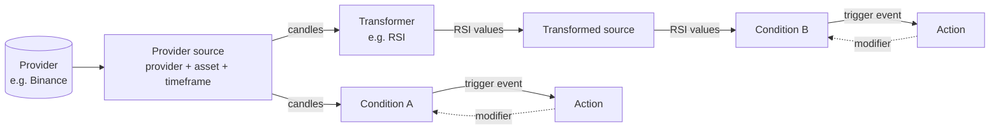

# ilus — Specification

> Status: draft · Last updated: 2026-11-16

## 1. Overview
ilus is a market-monitoring bot that fetches market data from **sources**, detects user-defined **conditions** (e.g. candlestick patterns on the price chart), and executes the associated **action** when a condition triggers.

Two extra concepts make the pipeline flexible: **transformers** derive new sources from existing ones (e.g. an RSI source computed from a price source), and **modifiers** let an action send information back to a condition to change how it operates.

ilus is **not a trading-strategy engine**. It does not model strategies in terms of buy/sell signals, positions, or portfolio management. Its core abstraction is generic: *condition → action*. Placing an order is just one possible action among others (e.g. sending a notification, logging, calling a webhook).

## 2. Goals
- Fetch market data through pluggable **sources**. A default source is provided: a free, public crypto price/volume feed with 1-minute precision.
- Derive new sources from existing ones through **transformers** (e.g. price → RSI). Transformers can be chained.
- Detect conditions on asset prices or related data, typically patterns on the candlestick chart (e.g. hammer, engulfing, doji). A set of predefined conditions is provided.
- When a condition triggers, execute its associated action. A set of predefined actions is provided.
- Run as a long-lived bot: once started, it evaluates all defined conditions continuously and indefinitely.
- **No event is lost**: every detection is queued and processed by the action, in order. If the action is too slow, the source is slowed down (backpressure) instead of dropping events.
- Let actions change how a condition operates by sending it **modifiers** (e.g. switch the threshold set, watch only bearish patterns).
- Conditions are evaluated independently: while an action runs, other conditions keep being evaluated.
- Rules (source → optional transformers → condition → action, with their parameters) are **defined in Rust code**, not in a configuration file. Everything is statically typed: no dynamic loading, no runtime type checks.
- Source, transformer, condition, action and modifier types are implemented in Rust.

## 3. Non-goals
- Production readiness: ilus is a proof of concept (POC).
- Tooling to help develop new conditions or actions (no DSL, scripting, or UI).
- Configuration files: no JSON/TOML/YAML config for now. Changing rules means editing the code and rebuilding.
- Trading-strategy features: buy/sell signal modeling, position/portfolio management, backtesting, strategy optimization.

## 4. Glossary
| Term | Definition |
|------|------------|
| Source | A stream of data items used by conditions. Either a **provider source** (a **provider**, an **asset** and a **timeframe**; delivers closed candles) or a **transformed source** (another source passed through a transformer). |
| Transformer | Rust-implemented process that turns one source into another (e.g. price candles → RSI values). Its output is a new source. |
| Data item | One element of a source stream: a candle for provider sources, or the transformer's output type (e.g. an RSI value) for transformed sources. Always closed and timestamped. |
| Provider | Rust-implemented connector to a market-data service (e.g. Binance). |
| Timeframe | Duration of one candle (e.g. `1m`, `5m`, `1h`). |
| Condition | Rust-implemented detector that consumes a source's data stream and emits trigger events. It can be anything; candlestick patterns are the first kind provided. |
| Action | Rust-implemented operation executed when a condition triggers (e.g. send notification, call webhook, place order). Actions are generic, not limited to trading. |
| Candle | OHLCV bar (open, high, low, close, volume) for an asset over a fixed timeframe. |
| Pattern | A recognizable shape formed by one or more consecutive candles. |
| Rule | A configured binding of a source (possibly transformed), a condition and an action, with parameters, defined in Rust code. |
| Trigger event | Event emitted by a condition when it detects something; it is the input of the action. |
| Modifier | Event sent to a condition, mostly by an action, carrying information that changes how the condition operates (e.g. new thresholds, watched direction). |
| Price stream | Real-time feed of market data for an asset. |

## 5. Architecture
ilus is a pipeline:



1. **Source**: fetches the feed and emits closed data items (candles for provider sources).
2. **Transformer** *(optional, chainable)*: turns a source into a new source (e.g. candles → RSI values).
3. **Condition**: consumes one source's stream; when it detects something, emits a **trigger event**.
4. **Action**: receives the trigger event and executes. It may send **modifiers** back to a condition.

Stages are decoupled: a source can feed many transformers and conditions, and a slow action never blocks sources or other conditions.

## 6. Domain model
```rust
// Sketch: the implementation in `src/` is the reference (one module per entity).

/// Description of where data comes from (for logs and events).
enum SourceInfo {
    Provider { provider: String, asset: String, timeframe: Timeframe },
    Transformed { input: Box<SourceInfo>, transformer: String },
}

/// A typed stream of data items. Created once in code; cloning the handle
/// shares the same underlying stream (one connection / one computation).
struct SourceHandle<D: SourceData> { /* broadcast receiver + SourceInfo */ }

/// One closed, timestamped element of a source stream.
trait SourceData: std::fmt::Debug + Send + Sync + 'static {
    fn time(&self) -> DateTime<Utc>;
}

struct Candle {
    open_time: DateTime<Utc>,
    open: Decimal, high: Decimal, low: Decimal, close: Decimal,
    volume: Decimal,
}
impl SourceData for Candle { /* time() = open_time */ }

/// Item emitted by a transformed source: the input item, always forwarded,
/// plus the computed value (`None` during warm-up).
struct Derived<D, V> { data: D, value: Option<V> }
impl<D: SourceData, V> SourceData for Derived<D, V> { /* time() = data.time() */ }

/// Turns one source into another.
trait Transformer {
    type Input: SourceData;
    type Value;                    // computed value (e.g. Decimal for RSI)

    /// Called for each closed input item. Returns `None` while warming up.
    fn on_data(&mut self, item: &Self::Input) -> Option<Self::Value>;

    /// Number of input items needed before the first output (warm-up).
    fn warm_up(&self) -> usize;
}

/// What was detected. One variant per detectable situation.
enum TriggerEventType {
    BullishEngulfing,
    BearishEngulfing,
    Hammer,
    // ... one per pattern (F0)
    Other(&'static str),          // any other condition kind
}

/// What a condition returns; the rule adds the context to build a TriggerEvent.
struct Detection<V> { event_type: TriggerEventType, value: V }

/// Value produced by a condition when it triggers. Its meaning is specific
/// to the condition algorithm (e.g. a buy/sell signal), not to the source data.
trait TriggerValue: std::fmt::Debug + Send + Sync + 'static {}

struct TriggerEvent<V: TriggerValue, D: SourceData> {
    rule: String,                 // rule that produced it
    event_type: TriggerEventType, // what was detected
    value: V,                     // condition-specific value (e.g. buy signal)
    source: SourceInfo,           // where the data came from
    time: DateTime<Utc>,          // time of the triggering data item
    data: Arc<D>,                 // triggering data item (context only, shared)
}

/// Information sent to a condition to change how it operates.
/// Its meaning is specific to the receiving condition.
trait ModifierValue: std::fmt::Debug + Send + Sync + 'static {}

trait Condition {
    /// Type of data item consumed (must match the rule's source).
    type Input: SourceData;
    /// Type of value this condition emits.
    type Value: TriggerValue;
    /// Type of modifier this condition accepts.
    type Modifier: ModifierValue;

    /// Called for each closed data item; returns a trigger event when detected.
    /// The condition sees every item; every detection is queued by the rule.
    fn on_data(&mut self, item: &Self::Input) -> Option<Detection<Self::Value>>;

    /// Called when a modifier is received. An invalid modifier is rejected
    /// and leaves the condition unchanged.
    fn on_modifier(&mut self, modifier: Self::Modifier) -> Result<(), ModifierError>;
}

/// Handle given to an action to send modifiers to its rule's condition.
struct ModifierSender<M: ModifierValue> { /* channel */ }

/// An action is written for a given condition type, so event and modifier
/// types are checked by the compiler.
type EventOf<C> = TriggerEvent<C::Value, C::Input>;

trait Action<C: Condition> {
    async fn run(
        &mut self,
        event: EventOf<C>,
        modifiers: &ModifierSender<C::Modifier>,
    ) -> Result<(), ActionError>;
}

/// A rule binds a source, a condition and an action. Fully generic:
/// each rule runs as its own task with concrete types.
struct Rule<C: Condition, A: Action<C>> {
    name: String,
    source: SourceHandle<C::Input>,
    condition: C,
    action: A,
}

// Example: candlestick pattern conditions.
enum PatternSignal { Bullish, Bearish }
impl TriggerValue for PatternSignal {}

enum PatternModifier {                   // examples only
    SetThresholdSet(String),             // e.g. switch to "strict"
    WatchOnly(Option<PatternSignal>),    // only bullish, only bearish, or both
}
impl ModifierValue for PatternModifier {}

struct PatternCondition { /* threshold set, history window, EMA... */ }
impl Condition for PatternCondition {
    type Input = Candle;
    type Value = PatternSignal;
    type Modifier = PatternModifier;
    /* ... */
}

/// Wires sources, transformers and rules, then runs them concurrently.
/// Everything is registered before `run`, so no consumer misses data.
struct Bot { /* tasks */ }

// Example: rules defined in main.rs
async fn main() {
    let mut bot = Bot::new();
    let btc_1m = bot.source(Binance::new("BTCUSDT", Timeframe::M1)); // SourceHandle<Candle>
    let btc_rsi = bot.transform(&btc_1m, Rsi::new(14));               // stream of Derived<Candle, Decimal>

    bot.rule(Rule::new("btc-patterns", &btc_1m, PatternCondition::new(ThresholdSet::default()), Alert));
    bot.rule(Rule::new("btc-rsi-low", &btc_rsi, RsiBelow::new(dec!(30)), Alert));
    bot.run().await;
}
```

Because rules are built in code, mismatches (a pattern condition on an RSI source, an action that does not match its condition's value or modifier type) are **compile errors**, not runtime errors.

## 7. Features

### F0 — Predefined candlestick pattern conditions
**Why:** Candlestick patterns are the primary kind of condition ilus detects. A reference set of 13 classic patterns is provided out of the box.

**General rules:**
- A pattern is only checked once its last candle has **closed**. A trigger is never emitted for a candle still in progress, and once emitted it is never withdrawn.
- A given pattern triggers at most once per candle.
- Multiple patterns can match the same candle. Since a condition emits one event at a time, see Open questions for how this is resolved.
- Detection starts only once enough closed candles exist to compute the averages (`AVG_LEN`) and the trend reference used by the pattern.

**Candle measures** — computed on a closed candle with open `O`, high `H`, low `L`, close `C`:
- **Body**: distance between open and close, `|C − O|`.
- **Range**: full height of the candle, `H − L`.
- **Upper shadow**: part above the body, `H − max(O, C)`.
- **Lower shadow**: part below the body, `min(O, C) − L`.
- **Bullish / bearish**: the candle closed higher (`C > O`) / lower (`C < O`) than it opened.
- **Midpoint** of a candle's body: `(O + C) / 2`.
- **Typical body / typical range**: mean body / mean range of the `AVG_LEN` candles preceding the candle under test (the candle itself is excluded).
- **Prior trend**: *down* if the close is below its exponential moving average of period `TREND_LEN`, *up* if above, *flat* if equal. Patterns read the trend just **before** the pattern begins (on the candle preceding its first candle).
- **Equality tolerance**: two values are considered equal when they differ by less than `EPSILON × price`, so that exact threshold hits are handled consistently.

**Threshold sets:** candlestick definitions vary between authors and tools, so ilus is designed to support **several threshold sets** (e.g. strict, loose, author-specific). For now only one set is defined: `default`, holding the most commonly used values below. The implementation must keep thresholds as data (not hard-coded in pattern logic) so that new sets can be added without changing pattern code.

**Default threshold set (`default`):**

| Name | Default value | Meaning |
|---|---|---|
| `AVG_LEN` | 10 | candles used for typical body / range |
| `TREND_LEN` | 20 | EMA period for the prior trend |
| `LONG_SHADOW` | 2 | a "long" shadow is at least this many times the body |
| `SHADOW_SHARE` | 0.6 | a dominant shadow covers at least this share of the range |
| `TINY_SHADOW` | 0.1 | a "missing" shadow is at most this share of the range |
| `DOJI_BODY` | 0.05 | max body/range ratio for a doji |
| `DOJI_MIN_RANGE` | 0.5 | a doji's range must be at least this share of the typical range |
| `STAR_BODY` | 0.3 | max body of a star's middle candle, relative to the first candle's body |
| `EPSILON` | 1e-9 | relative equality tolerance |

**Patterns** — candles are named *first*, *second*, *third* in time order; the last one is the candle that just closed. Every pattern requires a non-zero range where ranges are used.

| # | Pattern | Signal | Candles | Definition |
|---|---|---|---|---|
| 0 | Bullish Engulfing | bullish | 2 | Prior trend down. First candle bearish, second bullish. Second body opens at or below the first close, closes at or above the first open, and is strictly larger than the first body. |
| 1 | Bearish Engulfing | bearish | 2 | Mirror of Bullish Engulfing: prior trend up, first bullish, second bearish and wrapping the first body. |
| 2 | Hammer | bullish | 1 | Prior trend down. Lower shadow ≥ `LONG_SHADOW` × body and ≥ `SHADOW_SHARE` × range; upper shadow ≤ `TINY_SHADOW` × range. |
| 3 | Hanging Man | bearish | 1 | Same shape as Hammer, prior trend up. |
| 4 | Inverted Hammer | bullish | 1 | Prior trend down. Upper shadow ≥ `LONG_SHADOW` × body and ≥ `SHADOW_SHARE` × range; lower shadow ≤ `TINY_SHADOW` × range. |
| 5 | Shooting Star | bearish | 1 | Same shape as Inverted Hammer, prior trend up. |
| 6 | Doji | opposite of prior trend | 1 | Body ≤ `DOJI_BODY` × range, range ≥ `DOJI_MIN_RANGE` × typical range, prior trend not flat. |
| 7 | Morning Star | bullish | 3 | Prior trend down. First candle bearish with a body at least the typical body. Second candle's body ≤ `STAR_BODY` × first body, and its lower body edge at or below the first close. Third candle bullish, closing above the first candle's midpoint. |
| 8 | Evening Star | bearish | 3 | Mirror of Morning Star: prior trend up, first bullish, second small with its upper body edge at or above the first close, third bearish closing below the first midpoint. |
| 9 | Bullish Harami | bullish | 2 | Prior trend down. First candle bearish with a body at least the typical body. Second candle bullish, its body contained within the first body and strictly smaller. |
| 10 | Bearish Harami | bearish | 2 | Mirror of Bullish Harami: prior trend up, first bullish and large, second bearish and contained. |
| 11 | Piercing Line | bullish | 2 | Prior trend down. First candle bearish with a body at least the typical body. Second candle bullish, opens at or below the first close, closes strictly between the first midpoint and the first open. |
| 12 | Dark Cloud Cover | bearish | 2 | Mirror of Piercing Line: prior trend up, first bullish and large, second bearish opening at or above the first close and closing strictly between the first open and the first midpoint. |

**Acceptance criteria:**
- [ ] Each of the 13 patterns has unit tests with at least one matching and one non-matching candle sequence, built from original hand-crafted data.
- [ ] Given a candle that is still forming, When it matches a pattern, Then no trigger fires until the candle closes.
- [ ] Given fewer closed candles than required for averages and trend, Then no pattern triggers.
- [ ] *(Optional, local only, never committed)* Results may be cross-checked against other open-source detectors on the same price history; differences must be explainable by differing definitions.

**Edge cases & errors:**
- Zero-range candles (`H == L`): range-based patterns do not trigger (no division by zero).
- Values landing exactly on a threshold: resolved via `EPSILON`.
- Flat prior trend: trend-dependent patterns do not trigger.

### F1 — Sources
**Why:** Conditions need market data, and data can come from many providers (exchanges, APIs, files). A *source* isolates how data is fetched from how it is analysed, so conditions never depend on a specific provider.

**Behavior:**
- A **provider source** is defined by three elements:

  | Element | Meaning | Example |
  |---|---|---|
  | `provider` | where to get the feed | `binance` |
  | `asset` | the asset/pair to track, in the provider's symbol format | `BTCUSDT` |
  | `timeframe` | candle precision | `1m` |

  ```rust
  let btc_1m = bot.source(Binance::new("BTCUSDT", Timeframe::M1));
  ```
- A provider source delivers a stream of **closed candles** (OHLCV) in chronological order.
- A **transformed source** is defined by an input source, a transformer and its parameters (see F4). It inherits the asset and timeframe of its input.
- Sharing is explicit in code: a source is created once and its handle is cloned for each consumer. All clones share one connection.
- Provider sources deliver **candles only** (price and volume). Other provider data (order book, trades, external indicators) is out of scope for now. Derived data (e.g. RSI) is produced by transformers.
- The timeframe is requested directly from the provider (ilus does not aggregate candles). It is fixed at startup and does not change while running.
- A source may start at **any time in the past** (optional `start` parameter): candles from `start` to now are replayed through the conditions, then the source switches to live data. Without `start`, it backfills only what the conditions need.
- A source signals whether a candle is closed; only closed candles are passed to conditions (see F0).
- At startup, a source may load enough recent history (backfill) for conditions to have their required look-back (averages, trend).
- Several rules using the same source handle share a single connection; data is fetched once and dispatched to all of them.

**Default source:**
- A free, public crypto feed that requires no account or API key.
- Provides price and volume (OHLCV) with **1-minute** precision.
- Real-time (push/streaming preferred over polling).
- Provider: **Binance public market-data API** (spot), default asset `BTCUSDT`, interval `1m`.
  - History/backfill: REST `GET https://api.binance.com/api/v3/klines?symbol=BTCUSDT&interval=1m&limit=1000` (max 1000 candles per call).
  - Live: WebSocket `wss://stream.binance.com:9443/ws/btcusdt@kline_1m`; a candle is closed when the message field `k.x` is `true`.
  - Fallback endpoints (market data only): `https://data-api.binance.vision`, `wss://data-stream.binance.vision` (selectable with `with_endpoints`).
  - Start: live only (default), `with_history(n)` (last `n` closed candles first) or `with_start(time)` (every candle since `time` first).
  - End: `with_end(time)` replays history only (candles closed before `time`, capped at now), then the source ends without switching to live data.
  - The symbol is checked at startup; an unknown symbol stops the source with `SourceError::Unknown`.
  - REST errors are retried up to 5 times (backoff 1 s → 60 s; `Retry-After` honored on HTTP 429/418), then the source stops.
  - No WebSocket message for 60 s → reconnect. After each reconnection, missing candles are fetched over REST before live data resumes.
  - Prices and volumes are received as strings and must be parsed to `Decimal` (never floats).

**Test sources:**
- **Mock source**: delivers hand-crafted candles from memory; used by `cargo test` (no network in automated tests).
- **Replay source** (optional): replays candles recorded from Binance in a JSON file, for manual end-to-end checks.

**Acceptance criteria:**
- [ ] Given a running default source for `BTC/USDT` 1m, When a minute ends, Then exactly one closed candle is delivered to subscribed conditions.
- [ ] Given two rules using clones of the same source handle, Then only one connection to the provider is opened.
- [ ] Given a condition needing N candles of history, When the bot starts, Then the source backfills at least N closed candles before live evaluation.
- [ ] A source can be replaced by a test/mock source delivering candles from memory, without changing condition code.

**Edge cases & errors:**
- Connection lost: reconnect automatically with backoff; log the outage.
- Gap after reconnect: fetch missing candles before resuming, so no candle is skipped or duplicated.
- Duplicate or out-of-order candles from the provider: ignored.
- Missing candle: the source refetches it, up to N retries (with backoff); if it still fails, the error is logged and the source stops.
- Provider rate limits: respected; never exceeded.
- Unknown asset/timeframe at the provider: fail at startup with a clear error.

### F2 — Conditions
**Why:** Conditions are the detection stage of the pipeline. They are generic so that new kinds of detection (patterns, price thresholds, indicators, volume spikes…) can be added without changing sources or actions.

**Behavior:**
- A condition takes as input the closed data stream of **exactly one** source, either a provider source (candles) or a transformed source (e.g. RSI values). It declares the data type it expects.
- It keeps whatever internal state it needs (history window, indicators…).
- When it detects its situation, it emits a **trigger event** sent to the rule's action. It emits at most one event at a time; a condition may emit events of different types (e.g. one pattern condition can detect several patterns).
- **Event queue**: every detection becomes a trigger event, queued for the rule's action. The action processes events one at a time, in detection order. No event is ever dropped.
- **Backpressure**: a rule holds at most `max_pending` events (default 64, `Rule::with_max_pending`). When the limit is reached, the rule stops reading its input until the queue is **empty**, then resumes. Source channels are bounded (default 256 items), so the pause propagates upstream: transformers and the source wait when their channel is full. For a live source, a long pause may cause a disconnection; the reconnection gap-fill (F1) then recovers the missed candles, so none is lost.
- A condition knows nothing about providers, transformers or actions; it only sees data items, produces events and receives modifiers (F5).
- Each condition instance is independent: same type with different parameters = different instances.
- First kind provided: candlestick patterns (F0). Other kinds may be added later.

**Acceptance criteria:**
- [ ] Given a mock source feeding a known candle sequence, When a condition matches, Then exactly one trigger event is emitted with the triggering data item and the condition's value.
- [ ] Given a condition that does not match, Then no event is emitted.
- [ ] Given an action slower than the feed, Then every detection is processed, in order (none lost).
- [ ] Given a burst of items, Then every detection is processed, in order.
- [ ] Given `max_pending` events waiting, Then the rule stops reading its input until the queue is empty.
- [ ] A new condition type can be added by implementing the condition trait, with no change to sources or actions.

**Edge cases & errors:**
- A condition error (e.g. invalid internal state) is logged and does not stop the other conditions or the source.
- Condition input type does not match the source data type (e.g. a candlestick pattern on an RSI source): compile error.

### F3 — Actions
**Why:** Actions are the last stage of the pipeline: they react to trigger events.

**Behavior:**
- An action receives a trigger event and executes.
- While running, an action may send **modifiers** to its rule's condition (see F5).
- Events are processed one at a time, in detection order. When an action finishes (success or failure), the next queued event is processed.
- Actions run independently: a slow action never blocks sources or other rules.
- There is no dry-run mode; testing is done with the **alert** action.

**First action — Alert:**
- Writes the trigger event (rule, event type, value, source, time, data item) to the console/log. The value is printed via its `Debug` representation, so the alert action works with any condition.

**Acceptance criteria:**
- [ ] Given a trigger event, When the alert action runs, Then the event is printed with all its fields.
- [ ] Given a failing action, Then the error is logged and the next event is processed.

### F4 — Transformers
**Why:** Many conditions work on derived data (indicators such as RSI) rather than raw prices. A transformer computes that data once and exposes it as a new source, so conditions stay simple and the computation is shared.

**Behavior:**
- A transformer takes **one input source** and produces **one output source** (a transformed source).
- The input can be a provider source or another transformed source: transformers can be **chained** (e.g. candles → EMA → RSI). Chains must be acyclic.
- A transformer **always forwards its input data**: for every input item it emits exactly one output item, `Derived { data, value }`, holding the input item unchanged and the computed value. Output items are therefore closed and in the same order as the input.
- During **warm-up** (not enough input yet, e.g. the first 14 changes for RSI 14), the value is `None`; the input item is still forwarded.
- The transformed source inherits the asset and timeframe of its input.
- A transformed source is created once in code; cloning its handle shares the same computation among all consumers.
- Warm-up is propagated upstream: the provider source backfills enough history for the transformer warm-up **plus** the look-back of the conditions consuming its output.
- A transformer only sees data items and modifiers; it knows nothing about conditions or actions.
- A transformer may accept **modifiers** (F5), applied between two input items, in send order. Its handle (`Transformed::modifier_sender`) is given to actions when the pipeline is built. When its input ends, the transformer closes its output but keeps applying modifiers until every handle is dropped, so that modifiers sent late (e.g. by an action still processing queued events) are not lost.

**Example** (RSI 14 on BTCUSDT 1m closes):
```rust
let btc_1m = bot.source(Binance::new("BTCUSDT", Timeframe::M1));
let btc_rsi = bot.transform(&btc_1m, Rsi::new(14));
```

**First transformer — RSI (Relative Strength Index):**
- Input: candles. Output: `RsiCandle = Derived<Candle, Decimal>`: each candle with its RSI (0 to 100), `None` during warm-up.
- Parameter: `period` (default 14), computed on closes.
- For each new candle, the change is `close − previous close`; a *gain* is a positive change, a *loss* the absolute value of a negative change (the other is 0).
- The first average gain/loss is the plain mean over the first `period` changes. Afterwards each average is smoothed: `avg = (previous avg × (period − 1) + current) / period` (Wilder smoothing).
- `RSI = 100 − 100 / (1 + avg gain / avg loss)`. If avg loss is 0, RSI is 100 (and 50 if both are 0).
- Warm-up: `period + 1` candles before the first output.

**Acceptance criteria:**
- [ ] Given a mock source and an RSI transformer, When fewer than `period + 1` candles have been fed, Then no output is emitted.
- [ ] Given a hand-computed candle sequence, Then the RSI output matches the expected values (exact `Decimal` comparison, with a documented rounding).
- [ ] Given two rules using clones of the same transformed source handle, Then the transformer runs once and both conditions receive the same items.
- [ ] Given a chain of two transformers, Then the backfill covers both warm-ups plus the condition look-back.
- [ ] A new transformer can be added by implementing the transformer trait, with no change to sources, conditions or actions.

**Edge cases & errors:**
- Transformer input type does not match its input source data type: compile error.
- Cycles cannot be built: a transformer takes an existing source handle as input.
- Division by zero (e.g. avg loss = 0): handled explicitly by the transformer's definition, never a panic.
- A transformer error is logged; its output source stops, and so do the conditions consuming it; other sources and rules continue.

### F5 — Modifiers
**Why:** An action sometimes needs to change how a condition behaves after reacting to an event (e.g. after a bullish signal, watch only bearish patterns; switch to a stricter threshold set). Modifiers carry that information back to the condition without coupling actions to condition internals.

**Behavior:**
- A modifier is an event **sent mostly by actions** and **received by a condition or a transformer**.
- An action always receives a sender for the condition of **its own rule**. To reach a transformer, the action is given that transformer's sender (`Transformed::modifier_sender`) when the pipeline is built; senders can be cloned.
- Each condition or transformer type defines the modifiers it accepts; a mismatch is a compile error.
- Each condition type defines the modifiers it accepts (its own modifier type); their meaning is specific to the condition.
- Modifiers are delivered **in the order they were sent**.
- A modifier is applied **between two data items**, never while the condition is processing one. It takes effect from the next data item.
- A modifier affects the **next data items** only. Events already queued (detected before the modifier was applied) are not changed or removed.
- Modifier effects live in memory only: on restart, conditions start again from their definition in code.

**Example** (pattern condition): an action receives a *Bullish Engulfing* event, sends `WatchOnly(Bearish)`, then finishes. From the next candle, the condition only triggers on bearish patterns.

**Acceptance criteria:**
- [ ] Given an action that sends a modifier, Then the modifier applies to the next data items.
- [ ] Given two modifiers sent in sequence, Then they are applied in the same order.
- [ ] Given a modifier received while a data item is being processed, Then it is applied only after that item and affects the next one.
- [ ] Given an invalid modifier (e.g. unknown threshold set), Then it is rejected, the error is logged and the condition is unchanged.

**Edge cases & errors:**
- Modifier type not accepted by the target condition: compile error (the action is typed for its condition).
- Target condition stopped (e.g. its source failed): the modifier is dropped and logged.

### F6 — RSI divergence condition
**Why:** Near the end of a trend, the RSI often turns before the price. In a bear phase the price makes a lower minimum while the RSI already makes a higher minimum; in a bull phase the price makes a higher maximum while the RSI makes a lower maximum. Detecting this change is a classic reversal warning.

**Input:** `RsiCandle` (candle + RSI, output of the RSI transformer, F4).

**Pivots** (local minimum / maximum), parameters `left` and `right`:
- A candle is a **minimum pivot** if its low is strictly lower than the lows of the `left` candles before it, and lower than or equal to the lows of the `right` candles after it.
- A candle is a **maximum pivot** if its high is strictly higher than the highs of the `left` candles before it, and higher than or equal to the highs of the `right` candles after it.
- (Strict on the left, non-strict on the right: a flat bottom/top gives exactly one pivot, the first candle.)
- A pivot is only known `right` candles later: it is **confirmed** when the `right`-th candle after it closes. Detections are emitted at confirmation time, never earlier.
- A pivot is recorded with its price (low for a minimum, high for a maximum) and the RSI of the same candle. A pivot whose candle has no RSI yet (warm-up) is ignored.

**Divergences** — each new pivot is compared with the **previous pivot of the same kind** (A = previous, B = new):

| Kind | Pivots | Price | RSI |
|---|---|---|---|
| Bullish (bear phase) | minima | `price B < price A` | `RSI B > RSI A` |
| Bearish (bull phase) | maxima | `price B > price A` | `RSI B < RSI A` |

- The time between A and B (measured on the pivot times, so independent of the timeframe and of missing candles) must be within `[min_gap, max_gap]`, bounds included; otherwise no divergence (too close = noise, too far = unrelated).
- Whatever the result, B becomes the new previous pivot.

**Default parameters** (`DivergenceParams::for_timeframe`; `Default` = 1m):

| Name | Default value | Meaning |
|---|---|---|
| `left` | 3 candles | candles before a pivot |
| `right` | 3 candles | candles after a pivot (confirmation delay) |
| `min_gap` | 5 candles at 1m (5 min), 3 at 5m (15 min), 2 from 15m up (30 min at 15m) | min time between A and B |
| `max_gap` | 60 candles (1 h at 1m, 15 h at 15m) | max time between A and B |

The gaps are durations whose defaults depend on the candle duration, so a timeframe change keeps a sensible meaning.

**Detection value:** kind (bullish/bearish), pivot A and pivot B (time, price, RSI), confirmation time. Event types: `BullishDivergence`, `BearishDivergence`.

**Acceptance criteria:**
- [ ] Given a lower price minimum with a higher RSI, Then a bullish divergence is emitted when pivot B is confirmed.
- [ ] Given a higher price maximum with a lower RSI, Then a bearish divergence is emitted when pivot B is confirmed.
- [ ] Given a lower price minimum with a lower RSI, Then nothing is emitted.
- [ ] Given pivots closer than `min_gap` or farther than `max_gap` (in time), Then nothing is emitted.
- [ ] The default gaps depend on the timeframe (e.g. 30 min minimum at 15m).
- [ ] No detection is emitted before the `right` candles after pivot B have closed.
- [ ] A pivot without RSI (warm-up) is ignored.
- [ ] Invalid parameters (`left` or `right` = 0, negative `min_gap`, `min_gap > max_gap`) are rejected.

### F7 — Chart transformer
**Why:** To understand a strategy, one needs to see the candles, the indicator and the trades together.

**Behavior** (cargo feature `chart`, crates `eframe` + `egui_plot`):
- `chart(title, indicator_name)` creates a `Chart` transformer and a `ChartWindow`.
- The transformer accepts candles, or candles with an indicator value (e.g. `RsiCandle`). Like every transformer it forwards every input item (value `()`), and sends each candle to the window.
- It accepts the modifier `ChartModifier::Marker { time, price, kind, label }`, sent by actions. Kinds: buy/long, sell/short, close, stop-loss, liquidation.
- The window shows the candles (green up / red down) with the markers, and the indicator in a second panel (with 30/70 lines), both on a shared time axis. It refreshes while data arrives.
- Navigation: mouse wheel zooms the time axis around the cursor (both panels stay aligned); left-drag pans; right-drag zooms on a box; double-click resets. Toolbar: zoom in / out, *Fit all*, *Last 6h / 1d / 3d*, and *Auto-fit price* (on by default: the price axis fits the visible candles and markers; off: the price axis can be zoomed and dragged freely).
- The window must run on the main thread; the bot runs in another thread. Closing the window does not stop data forwarding.
- Prices are converted to `f64` for display only.

**Acceptance criteria:**
- [ ] Every input item is forwarded, also when the window is closed.
- [ ] Each candle is sent to the window with its indicator value; each marker modifier is sent to the window.

## 8. Interfaces
- **Configuration**: none. Rules are defined in Rust code (`main.rs` or a `rules` module). Changing rules requires a rebuild.
- **CLI**: to be defined (at least: start the bot).

## 9. Constraints
- Performance:
- Reliability / recovery:
- Security (API keys, secrets):

## 10. License
ilus is released under the **GNU GPL v3.0 or later** (GPL-3.0-or-later).

## 11. Decisions
- Default source provider: Binance public API. Alternatives if geo-restricted later: Bybit, OKX, Kraken, Coinbase.
- Provider sources deliver candles only (price and volume). Derived data comes from transformers.
- One source per condition (provider or transformed).
- Transformers: one input source → one output source, chainable, shared when identical.
- Modifiers: sent mostly by actions to a condition or a transformer; ordered; applied between data items, affecting the next ones; in memory only.
- Timeframes are requested from the provider, fixed at startup.
- No event is lost: detections are queued (max `max_pending`, default 64); when full, the rule pauses its input until the queue is empty, slowing the source through bounded channels. (Replaces the earlier one-shot arming, which dropped events during fast history replays.)
- A condition emits one event at a time, possibly of different event types.
- No configuration file: rules are defined in Rust code and fully statically typed (no dynamic dispatch needed for wiring).
- No dry-run mode; the alert action is used for testing. A source can start at any time in the past.
- Licensing: only public-domain pattern definitions are used; no external code, tests, or data are copied into ilus. Project license: GPL-3.0-or-later.

## 12. Open questions
- F6: pivots use the candle low/high. Should closes be an option?
- F6: should "hidden" divergences (trend continuation: higher price low with lower RSI low) be detected too?
- How does a rule select a threshold set in code (e.g. `ThresholdSet::default()`)? Can individual values be overridden per rule? → to decide during development.
- Which additional threshold sets to define later, and from which sources? → later.
- ~~Value of N~~ → resolved: 5 retries with exponential backoff (1 s → 60 s).
- If several patterns match the same candle in one condition, which event is emitted: the first by table order, one event listing all matches, or one condition instance per pattern?
- Modifier senders: "mostly by actions". Who else can send them: other conditions, an external command (CLI), a timer?
- Modifier target: can an action send a modifier to the condition of **another** rule (addressed by rule name)?
- Could a transformer aggregate candles (e.g. 1m → 5m)? This conflicts with the current decision that timeframes come from the provider.
- RSI: confirm defaults (`period` 14, on close, Wilder smoothing) and the rounding of the output.
